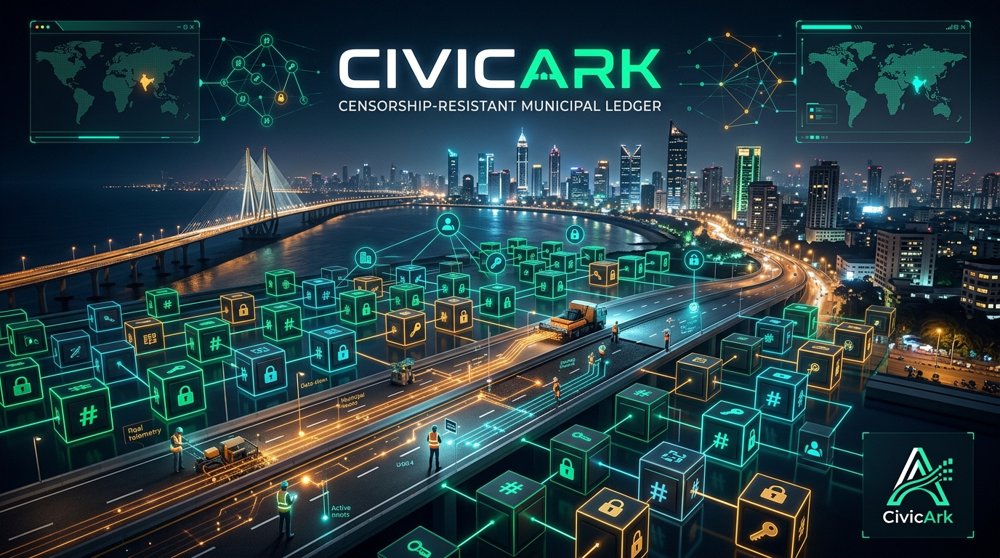

# CivicArk 🏛️⚡
> **Censorship-Resistant Municipal Tender & Defect-Liability Ledger on Arkiv**  
> *A Production-Grade Decentralized Public Infrastructure & Warranty Verification Platform*  
> *Built on Arkiv DB-Chain L3 · Aligned with the Ethereum Foundation CROPS Architecture*

<div align="center">

[](LICENSE)
[-emerald.svg?style=for-the-badge)](https://tiramisu.explorer.arkiv.network)
[](https://www.npmjs.com/package/@arkiv-network/sdk)
[-orange.svg?style=for-the-badge)](https://openrouter.ai)
[](https://assemblyai.com)

</div>

---

## Table of Contents
1. [Executive Summary & The Real-World Problem](#1-executive-summary--the-real-world-problem)
2. [Ethereum Foundation CROPS Alignment](#2-ethereum-foundation-crops-alignment)
3. [Why Arkiv? (Architectural Justification)](#3-why-arkiv-architectural-justification)
4. [System Architecture](#4-system-architecture)
5. [Interactive GIS Municipal Mapping](#5-interactive-gis-municipal-mapping)
6. [Arkiv Primitives & Technical Implementation](#6-arkiv-primitives--technical-implementation)
7. [Nagrik Saathi: Multilingual AI & Real-Time Voice](#7-nagrik-saathi-multilingual-ai--real-time-voice)
8. [Tiramisu Testnet Details & Authority Personas](#8-tiramisu-testnet-details--authority-personas)
9. [Step-by-Step Installation & Local Setup](#9-step-by-step-installation--local-setup)
10. [Configuration & Environment Variables](#10-configuration--environment-variables)
11. [Production Deployment & Containerization](#11-production-deployment--containerization)
12. [Five-Minute End-to-End Evaluation Flow](#12-five-minute-end-to-end-evaluation-flow)
13. [Codebase Architecture & Directory Structure](#13-codebase-architecture--directory-structure)
14. [Technical Verification Artifacts](#14-technical-verification-artifacts)
15. [License](#15-license)

---

## 1. Executive Summary & The Real-World Problem

### The Monsoon Road Defect Crisis & Bureaucratic Amnesia
Every monsoon across Indian metropolitan regions (such as Mumbai, Bengaluru, and Pune), municipal corporations like the **Brihanmumbai Municipal Corporation (BMC)** disburse upwards of **₹2,000 Crore to ₹4,000 Crore** on road resurfacing, mastic asphalt laying, and storm drainage. Within weeks of torrential precipitation, newly paved road corridors crater into hazardous potholes, contributing to traffic gridlock and thousands of road fatalities annually.

Under municipal engineering statutes, public works contracts carry a mandatory **Defect Liability Period (DLP)**—a binding warranty of **3 to 5 years**. During this period, the awarded contractor is legally required to repair all structural damage and potholes at **zero expense to the public exchequer**.

```
Existing Centralized Failure Loop:
┌────────────────────┐       ┌──────────────────────┐       ┌────────────────────────┐
│ ₹2,000 Cr+ Spend   │ ────> │  Monsoon Road Decay  │ ────> │ Citizens / RTI Request │
└────────────────────┘       └──────────────────────┘       └────────────────────────┘
                                                                        │
                                                                        ▼
                                                            ┌────────────────────────┐
                                                            │ "Server Maintenance"   │
                                                            │ Lost Tender Records    │
                                                            │ Retroactive DB Updates │
                                                            └────────────────────────┘
```

### The Institutional Vulnerability
When citizens, journalists, and Right to Information (RTI) researchers investigate contractor warranties:
- Centralized municipal portals display *"Server Under Maintenance"* during anti-corruption inquiries.
- Database administrators with SQL root access can alter rows, delete penalty clauses, or reset warranty dates under political influence.
- Physical project files and NABL-certified compaction test records are lost in bureaucratic transit.
- Public funds are continuously re-allocated to resurface roads that were already covered by existing contractor warranties.

### The CivicArk Solution
**CivicArk** anchors municipal infrastructure tenders, statutory Defect Liability Periods, NABL laboratory compaction reports, and citizen defect challenges as **immutable, wallet-owned entities on Arkiv DB-Chain**.

By leveraging Arkiv's native primitives—typed query indexing, cryptographic wallet ownership, time-scoped lifecycle eviction (TTL), and trustless client-side querying—CivicArk ensures that:
- **Warranty Terms Cannot Be Deleted:** No municipal vendor or administrator can rewrite contract history.
- **Warranties Expire Transparently:** Entity storage lifetimes are cryptographically matched to statutory DLP durations.
- **Citizens Log Verified Challenges:** Public defect reports trigger automated on-chain penalty warnings and contractor rectification clocks.
- **Contractors Cryptographically Prove Completion:** Milestone updates require signed contractor wallet authorizations and verified IPFS laboratory hashes.

---

## 2. Ethereum Foundation CROPS Alignment

CivicArk implements the core architectural pillars defined by the Ethereum Foundation CROPS standard for public digital infrastructure:

| Pillar | Architectural Implementation |
| :--- | :--- |
| 🛡️ **Censorship Resistance** | Municipal contracts, contractor liability terms, and citizen defect filings are anchored to the Arkiv Tiramisu DB-Chain Keccak state trie. Records cannot be revoked, edited, or expunged by administrative pressure or server confiscation. |
| 🔓 **Open Source** | Permissive MIT-licensed codebase, client-side direct RPC verification, transparent entity schemas in [`arkiv/schema.md`](arkiv/schema.md), and reproducible engineering notes in [`arkiv/friction.md`](arkiv/friction.md). |
| 🔒 **Privacy & Data Protection** | Full compliance with India's **Digital Personal Data Protection (DPDP) Act**. Zero personal phone numbers, physical residential addresses, or Aadhaar identifiers are written to the chain. Citizens interact through pseudonymous EVM wallet addresses. |
| 🔐 **Security & Provenance** | Strict cryptographic role separation: only authorized Municipal Executive Engineer keys can sanction tenders; only awarded contractor keys can patch asphalt compaction test milestones; citizens cryptographically sign public defect challenges. |

---

## 3. "Why Arkiv?" (Architectural Justification)

Public infrastructure warranties require an auditable data layer capable of fast queries and cryptographic immutability. Traditional systems fail key requirements:

```
┌─────────────────────────────────────────────────────────────────────────────────────────────┐
│                                ARCHITECTURAL COMPARISON                                     │
├──────────────────────┬──────────────────────┬────────────────────────┬──────────────────────┤
│ Architecture         │ Tamper Resistance    │ Browser Query Engine   │ Direct Mutation CRUD │
├──────────────────────┼──────────────────────┼────────────────────────┼──────────────────────┤
│ PostgreSQL / MySQL   │ ❌ Single DB admin   │ ✅ Fast SQL queries    │ ✅ Unrestricted SQL  │
│                      │ can alter rows       │                        │ updates & deletes    │
├──────────────────────┼──────────────────────┼────────────────────────┼──────────────────────┤
│ IPFS / Arweave       │ ✅ Cryptographic hash│ ❌ Static blobs only;  │ ❌ Immutable blobs;  │
│                      │ immutability         │ no typed query engine  │ no state mutations   │
├──────────────────────┼──────────────────────┼────────────────────────┼──────────────────────┤
│ The Graph (Subgraph) │ ✅ Verifiable index  │ ✅ GraphQL queries     │ ❌ Read-only; needs   │
│                      │                      │                        │ separate EVM state   │
├──────────────────────┼──────────────────────┼────────────────────────┼──────────────────────┤
│ ARKIV DB-CHAIN       │ ✅ Keccak Trie       │ ✅ Native Typed SDK    │ ✅ Direct entity CRUD│
│                      │ Cryptographic State  │ Query Engine in Client │ with patchEntity     │
└──────────────────────┴──────────────────────┴────────────────────────┴──────────────────────┘
```

### Analysis:
1. **Why not PostgreSQL / MySQL?**  
   Centralized relational databases allow administrators to perform `UPDATE tenders SET dlp_years = 0` or delete records during formal investigations. CivicArk replaces administrative trust with verifiable cryptographic signatures.
2. **Why not IPFS or Arweave alone?**  
   Static content-addressed networks store unstructured files. A citizen standing on S.V. Road in Ward K-West cannot query:  
   `"Find all active roadwork warranties in Ward K-West where budget > ₹1 Crore and status is warranty_active"`.  
   Arkiv provides native typed attribute indexing directly from the browser without third-party servers.
3. **Why not The Graph?**  
   Subgraphs only index events emitted by contracts on base EVM chains, introducing latency and requiring custom smart contract deployments for every field. Arkiv is a direct, writable database where `@arkiv-network/sdk` executes reads and writes with immediate query reflection.

### What Stays OFF Arkiv:
* **High-Density Drone LiDAR & Point Clouds:** Multi-gigabyte road scans are pinned to decentralized storage (IPFS/Walrus). Arkiv stores the cryptographic Content Identifiers (`ipfs://bafy...`).
* **Personally Identifiable Information (PII):** Zero personal identification documents or phone numbers are committed to the ledger.

---

## 4. System Architecture

```
                                  ┌───────────────────────────┐
                                  │      Citizen / Auditor    │
                                  │   MetaMask / Role Persona │
                                  └─────────────┬─────────────┘
                                                │
                                                ▼
┌─────────────────────────────────────────────────────────────────────────────────────────────┐
│                                   CIVICARK FRONTEND CORE                                    │
│                                                                                             │
│  ┌───────────────────────┐  ┌──────────────────────┐  ┌──────────────────────────────────┐  │
│  │   Dynamic Windows     │  │   Interactive GIS    │  │     Nagrik Saathi Assistant      │  │
│  │   Multiplayer HUD     │  │   BMC Ward GeoJSON   │  │   Speech / Voice / Multilingual  │  │
│  └──────────┬────────────┘  └──────────┬───────────┘  └────────────────┬─────────────────┘  │
└─────────────┼──────────────────────────┼───────────────────────────────┼────────────────────┘
              │                          │                               │
              │ Viem Transport           │ @arkiv-network/sdk            │ AssemblyAI & LLM
              ▼                          ▼                               ▼
┌───────────────────────────┐ ┌───────────────────────────┐ ┌─────────────────────────────────┐
│ Arkiv Tiramisu DB-Chain   │ │ Arkiv Public Client       │ │ Secure AI & Voice Gateway       │
│ Chain ID: 7738577         │ │ Direct Browser RPC        │ │ Node.js Express / Vercel API    │
│                           │ │                           │ │                                 │
│ • Typed Attributes        │ │ • `select()`              │ │ • Universal-3 STT WebSocket     │
│ • Expiration TTLs         │ │ • `where(eq(...))`        │ │ • Bidirectional Voice Agent WS  │
│ • `createEntity`          │ │ • `limit(50)`             │ │ • DeepSeek V4.1 Flash Tool Calls│
│ • `patchEntity`           │ │ • Zero-Indexer Queries    │ │ • Request-Only Ephemeral Tokens │
└───────────────────────────┘ └───────────────────────────┘ └─────────────────────────────────┘
              ▲                                                               │
              └───────────────────── Cryptographic Provenance ────────────────┘
```

---

## 5. Interactive GIS Municipal Mapping

CivicArk integrates real-time geospatial infrastructure mapping through [`RealWardMap.tsx`](src/components/RealWardMap.tsx):

- **Live BMC Ward Boundaries:** Fetches official municipal polygon boundaries directly from the MCGM GIS spatial directory (`prsrvgisapp.mcgm.gov.in`).
- **Interactive Geospatial Filters:** Allows citizens to select specific administrative wards (e.g., Ward K/W - Andheri West, Ward H/W - Bandra West, Ward G/S - Worli) to view localized road spend.
- **Geotagged Defect Clustering:** Displays citizen-reported potholes and pavement failures as geotagged markers, color-coded by severity (`Minor`, `Moderate`, `Critical`, `Hazardous`).
- **Real-Time Ward Metrics:** Calculates active tender density, total public funds allocated, and open defect counts dynamically from live Arkiv queries.

---

## 6. Arkiv Primitives & Technical Implementation

CivicArk utilizes the `@arkiv-network/sdk` for data modeling, lifecycle governance, and cryptographic state transitions:

### 1. Strongly Typed Attributes (`@arkiv-network/sdk/attr`)
Indexed entity attributes provide zero-indexer querying:
```typescript
import { str, u64, i32, addr } from '@arkiv-network/sdk';

const attributes = {
  app: str('civicark'),
  type: str('tender'),
  tender_id: str('BMC-2026-KW-RD-042'),
  city: str('Mumbai'),
  ward: str('K-West'),
  road_name: str('SV Road (Andheri to Juhu)'),
  category: str('roadwork'),
  status: str('warranty_active'),
  budget_inr: u64(18500000n), // ₹1.85 Crore
  contractor: addr('0x71C8364437a9238f63c7bc6ebeb277150186938a'),
  engineer: addr('0x2546bcd3c84621e976d8185a91a922ae77ecec30'),
  dlp_years: i32(3),
  defect_count: i32(0),
  dlp_expiry: u64(BigInt(Math.floor(Date.now() / 1000) + 86400 * 365 * 3)),
};
```

### 2. Time-Scoped Storage & Defect Liability Lifecycle (`ExpirationTime`)
Arkiv entities are assigned an expiration TTL mapped to their legal warranty lifespan:
```typescript
import { ExpirationTime } from '@arkiv-network/sdk';

// Automatically expires entity when statutory 3-year warranty concludes
const expires = ExpirationTime.fromDays(dlpYears * 365);
```
- **Statutory Warranty Duration:** Tenders remain indexed for the exact legal duration of the contractor warranty. Upon expiration, records self-prune from active defect sweeps, preventing perpetual state bloat.
- **Statutory 30-Day Rectification Window:** Citizen defect challenges carry a statutory 30-day contractor repair window (`ExpirationTime.fromDays(30)`). If unaddressed within 30 days, the tender transitions to `breached`.

### 3. Direct Browser Client Queries (`createPublicClient`)
Auditing requires no backend server or proprietary API keys:
```typescript
import { createPublicClient, str } from '@arkiv-network/sdk';
import { tiramisu } from '@arkiv-network/sdk/chains';
import { eq } from '@arkiv-network/sdk/query';
import { http } from 'viem';

export const publicClient = createPublicClient({
  chain: tiramisu,
  transport: http('https://rpc.tiramisu.db-chain.testnet.arkiv.network'),
});

// Direct client-side audit query
const result = await publicClient
  .select({ key: true, attributes: true, payload: true })
  .where(eq('app', str('civicark')), eq('type', str('tender')))
  .limit(50)
  .fetch();
```

### 4. Wallet-Owned Cryptographic Mutations (`patchEntity`)
Only authorized contractor and engineer keys can patch completion milestones:
```typescript
import { createWalletClient, str, jsonToPayload } from '@arkiv-network/sdk';

const arkivWallet = createWalletClient({
  chain: tiramisu,
  transport: custom(window.ethereum),
  account: contractorAddress,
});

await arkivWallet.patchEntity({
  entityKey: tenderEntityKey,
  set: { status: str('completed') },
  payload: jsonToPayload({
    milestones: updatedMilestonesWithNablProof,
  }),
  contentType: 'application/json',
});
```

---

## 7. Nagrik Saathi: Multilingual AI & Real-Time Voice

**Nagrik Saathi (नागरिक साथी)** is CivicArk's integrated AI co-pilot designed to democratize public records access across Indian linguistic demographics.

```
┌────────────────────────────────────────────────────────────────────────────────────────┐
│                                 NAGRIK SAATHI PIPELINE                                 │
├─────────────────────┬────────────────────────────────┬─────────────────────────────────┤
│ Audio Capture       │ Processing Engine              │ On-Chain Execution              │
├─────────────────────┼────────────────────────────────┼─────────────────────────────────┤
│ Citizen Voice Input │ AssemblyAI Streaming v3 WS     │ Autonomous Tool Calls:          │
│ (16kHz / 24kHz PCM) │ (Universal-3 Speech-to-Text)   │ • `search_tenders(ward, query)` │
│        │            ├────────────────────────────────┤ • `search_defects(tenderId)`    │
│        ▼            │ OpenRouter LLM Gateway         │ • `network_status()`            │
│ AudioWorklet Node   │ (DeepSeek V4.1 Flash Engine)   │ • `create_tender(...)`          │
│        │            ├────────────────────────────────┤                 │               │
│        ▼            │ AssemblyAI Bidirectional Voice │                 ▼               │
│ Speaker Audio Out   │ (Real-Time Audio Streaming)    │ User Interactive Wallet Confirm │
└─────────────────────┴────────────────────────────────┴─────────────────────────────────┘
```

### Key Technical Capabilities:
1. **13 Indian Languages Supported:** Communicates fluently in English, Hindi, Hinglish, Marathi (मराठी), Bengali (বাংলা), Tamil (தமிழ்), Telugu (తెలుగు), Gujarati (ગુજરાતી), Kannada (ಕನ್ನಡ), Malayalam (മലയാളം), Punjabi (ਪੰਜਾਬੀ), Odia (ଓଡ଼ିଆ), and Urdu (اردو).
2. **AudioWorklet Streaming:** Speech processing is offloaded from the UI thread to a dedicated browser `AudioWorkletNode` (`/public/pcm-processor.js`), streaming 16kHz and 24kHz PCM audio over WebSockets with zero main-thread audio degradation.
3. **Real-Time Speech-to-Text:** Direct integration with AssemblyAI's Universal-3 real-time speech engine (`wss://streaming.assemblyai.com/v3/ws`).
4. **Bidirectional Voice Agent:** Conversational voice interface powered by AssemblyAI's Live Agent WebSocket (`wss://agents.assemblyai.com/v1/ws`).
5. **Autonomous Function Calling:**
   - `search_tenders`: Queries live public tenders by ward or title.
   - `search_defects`: Inspects reported defect severity and warranty breaches.
   - `network_status`: Reads current Tiramisu block height and RPC latency.
   - `create_tender`: Prepares tender proposals for explicit user wallet signature.
6. **Strict Cryptographic Guardrails:** The model never fabricates transaction hashes or claims an on-chain action completed without cryptographic receipts from Arkiv.

---

## 8. Tiramisu Testnet Details & Authority Personas

CivicArk operates on the **Arkiv Tiramisu Testnet**:

* **Network Name:** Arkiv Tiramisu Testnet
* **Chain ID:** `7738577` (Hex: `0x761551`)
* **RPC Endpoint:** `https://rpc.tiramisu.db-chain.testnet.arkiv.network`
* **Block Explorer:** [tiramisu.explorer.arkiv.network](https://tiramisu.explorer.arkiv.network)
* **Native Gas Token:** `$GLM` (Golem Network Token)
* **Public Faucet:** [hub.arkiv.network/faucet](https://hub.arkiv.network/faucet)

### Pre-Configured Testnet Authority Personas

CivicArk includes verified authority personas for rapid evaluation without third-party wallet extensions:

| Authority Persona | Testnet Public Address | Operational Permissions |
| :--- | :--- | :--- |
| **Municipal Executive Engineer** | `0x2546bcd3c84621e976d8185a91a922ae77ecec30` | Sanctions public tenders, sets Defect Liability Period durations, issues formal breach notices. |
| **Authorized Road Contractor** | `0x71C8364437a9238f63c7bc6ebeb277150186938a` | Patches work completion milestones, commits NABL-certified compaction laboratory reports. |
| **Citizen & RTI Public Auditor** | `0x12bda589f2a0194857c320194857c320194857c3` | Audits ward records, submits cryptographic defect challenges, tracks 30-day rectification windows. |

---

## 9. Step-by-Step Installation & Local Setup

### Prerequisites
* **Node.js:** v20.x or v22.x LTS (compatible with Node.js v24+)
* **Package Manager:** `npm` (v10+)
* **Browser:** Chrome, Brave, or Edge (recommended for Web Audio and Speech APIs)

### 1. Clone the Repository
```bash
git clone https://github.com/sandman-sh/CivicArk.git
cd CivicArk
```

### 2. Install Dependencies
```bash
npm install
```

### 3. Configure Environment Variables
Copy `.env.example` to `.env`:
```bash
cp .env.example .env
# Windows PowerShell:
Copy-Item .env.example .env
```

### 4. Run the Project Locally

#### Start the Secure AI & Voice Gateway (Backend)
```bash
npm run gateway
```
*The gateway starts on `http://localhost:8787`.*

#### Start the Vite Development Server (Frontend)
In a separate terminal window:
```bash
npm run dev
```
*The Vite frontend starts on `http://localhost:5173` with automatic reverse proxying for `/api/*` requests to port `8787`.*

#### Run Linter and Production Build Checks
```bash
npm run check
```

---

## 10. Configuration & Environment Variables

| Variable | Description | Default Value | Required? |
| :--- | :--- | :--- | :--- |
| `PORT` | Local backend gateway port | `8787` | Yes |
| `OPENROUTER_API_KEY` | OpenRouter API credential | Set in `.env` | For AI chat |
| `OPENROUTER_MODEL` | OpenRouter LLM model slug | `deepseek/deepseek-v4.1-flash` | For AI chat |
| `OPENROUTER_API_URL` | OpenRouter completion endpoint | `https://openrouter.ai/api/v1/chat/completions` | For AI chat |
| `ASSEMBLYAI_API_KEY` | AssemblyAI API credential | Set in `.env` | For real-time voice |
| `ASSEMBLYAI_STT_MODEL`| Universal-3 streaming speech model | `u3-rt-pro` | For real-time voice |
| `VITE_ARKIV_CHAIN_ID` | Arkiv Tiramisu Chain ID | `7738577` | Yes |
| `VITE_ARKIV_RPC_URL` | Public Arkiv Tiramisu RPC endpoint | `https://rpc.tiramisu.db-chain.testnet.arkiv.network` | Yes |
| `VITE_ARKIV_EXPLORER_URL` | Arkiv Tiramisu block explorer | `https://tiramisu.explorer.arkiv.network` | Yes |

> [!NOTE]  
> CivicArk runs out-of-the-box for blockchain inspection and tender auditing even without external API credentials. If `OPENROUTER_API_KEY` or `ASSEMBLYAI_API_KEY` are omitted, the interface gracefully falls back to browser-native Web Speech recognition.

---

## 11. Production Deployment & Containerization

### Docker Deployment
CivicArk provides a production Docker container that serves both the compiled client bundle and the backend API gateway:

```bash
# 1. Build the Docker image
docker build -t civicark .

# 2. Run container with environment file
docker run --env-file .env -p 8787:8787 civicark
```
Access the application at `http://localhost:8787`. Secrets stay securely in the container environment and are never exposed in browser bundles.

### Vercel Serverless Deployment
CivicArk is pre-configured for Vercel using serverless endpoints in `/api`:
1. Import the repository into your Vercel Dashboard.
2. The project automatically applies `vercel.json` and uses the static build directory (`dist`).
3. In **Project Settings → Environment Variables**, add:
   - `OPENROUTER_API_KEY`
   - `OPENROUTER_MODEL`
   - `ASSEMBLYAI_API_KEY`
4. Deploy. The `/api/ai/chat`, `/api/stt-token`, and `/api/voice-token` functions will execute as serverless Node.js endpoints.

---

## 12. Five-Minute End-to-End Evaluation Flow

```
┌───────────────────────────────────────────────────────────────────────────────────┐
│                           EVALUATION WALKTHROUGH                                  │
├───────────────────────────────────────────────────────────────────────────────────┤
│  1. Launch App ──> 2. Select Persona ──> 3. Audit Warranties ──> 4. File Defect   │
│         │                                                                   │     │
│         └───────────> 5. Engage Nagrik Saathi Multilingual Voice <──────────┘     │
└───────────────────────────────────────────────────────────────────────────────────┘
```

1. **Access Application:** Open `http://localhost:5173`. Observe live Tiramisu block height and RPC latency telemetry in the header.
2. **Authenticate:** Click **Launch CivicArk App**. Select **Municipal Executive Engineer** for one-click access, or connect via MetaMask on Chain ID `7738577`.
3. **Audit Wards on GIS Map:** Open the **Interactive Ward Map**. Click on **Ward K/W (Andheri West)** to highlight active contracts and geotagged pothole clusters.
4. **Inspect Tender Cryptography:** Select tender **BMC-2026-KW-RD-042**. In the **Cryptographic Tender Inspector**, review the statutory 3-year warranty countdown and NABL compaction lab test hashes.
5. **Log a Defect Challenge:** Submit a defect report with severity `Critical`. Verify that the on-chain defect counter increments and the 30-day statutory contractor rectification countdown initiates.
6. **Interact with Nagrik Saathi:** Click the **Nagrik Saathi** badge in the bottom-right corner. In English, Hindi, or Hinglish, ask: *"Show active roadwork warranties in Ward K-West"*. Observe the autonomous tool call and synthesized response.

---

## 13. Codebase Architecture & Directory Structure

```
arkv/
├── api/                           # Vercel Serverless Functions
│   ├── ai/
│   │   └── chat.js                # Secure OpenRouter LLM proxy
│   ├── health.js                  # Gateway health status check
│   ├── stt-token.js               # Ephemeral AssemblyAI STT WebSocket tokens
│   └── voice-token.js             # Ephemeral AssemblyAI Voice Agent tokens
├── arkiv/                         # Arkiv Architecture Specifications
│   ├── friction.md                # Reproducible developer feedback & SDK analysis
│   └── schema.md                  # Entity types, attributes, TTL, and query specs
├── public/                        # Static assets & worklets
│   ├── banner.png                 # Official CivicArk widescreen banner
│   ├── favicon.svg                # Theme-adaptive vector favicon
│   ├── icons.svg                  # SVG symbol sprite sheet
│   └── pcm-processor.js           # AudioWorklet for low-latency PCM audio streaming
├── src/
│   ├── assets/                    # Static image assets
│   ├── components/                # React UI Components
│   │   ├── AuthModal.tsx          # Dual-mode authentication (MetaMask / Authority Personas)
│   │   ├── LandingPage.tsx        # High-impact editorial hero, metrics & architecture
│   │   ├── MainApp.tsx            # Multi-window dynamic workspace & Arkiv ledger HUD
│   │   ├── NagrikSaathi.tsx       # Multilingual AI assistant & real-time voice agent
│   │   ├── Navbar.tsx             # Sticky navigation header & network status indicator
│   │   ├── RealWardMap.tsx        # Leaflet GIS map with MCGM GeoJSON ward boundaries
│   │   ├── ThemeToggle.tsx        # Dark/light theme mode controller
│   │   └── WindowFrame.tsx        # Sizable, minimizable desktop window containers
│   ├── data/
│   │   └── wardDirectory.ts       # 24 Mumbai administrative ward geographic registry
│   ├── lib/
│   │   └── arkiv.ts               # Core Arkiv SDK queries, TTLs, and wallet mutations
│   ├── types/
│   │   └── civic.ts               # TypeScript types for tenders, defects, and sessions
│   ├── App.tsx                    # Main application router and session controller
│   ├── index.css                  # Monochromatic design system & typographic tokens
│   └── main.tsx                   # React client entry point
├── Dockerfile                     # Production container definition
├── index.html                     # HTML root with wallet extension collision safeguards
├── package.json                   # Dependencies & npm scripts
├── server.mjs                     # Standalone Node.js AI & voice gateway server
├── tsconfig.json                  # TypeScript configuration
├── vercel.json                    # Vercel deployment configuration
└── vite.config.ts                 # Vite bundler & reverse proxy configuration
```

---

## 14. Technical Verification Artifacts

| Document | Location | Purpose |
| :--- | :--- | :--- |
| 📑 **Entity Schema Specification** | [`arkiv/schema.md`](arkiv/schema.md) | Technical definitions of `tender` and `defect_challenge` entities, typed attributes, Defect Liability Period expirations, and SDK query syntax. |
| 🛠️ **Developer Friction Report** | [`arkiv/friction.md`](arkiv/friction.md) | Reproducible engineering report detailing SDK queries, numerical type casting, error handling, and runtime behavior. |
| ⚖️ **License File** | [`LICENSE`](LICENSE) | Full text of the MIT open-source license. |

---

## 15. License

This project is licensed under the **MIT License** — see the [LICENSE](LICENSE) file for complete details.

CivicArk is maintained by the open-source civic technology community to promote cryptographic accountability in public works administration.
